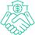

# 🏛️ Noble Aura — Luxury Real Estate & Properties

[](https://developer.mozilla.org/en-US/docs/Web/HTML)
[](https://developer.mozilla.org/en-US/docs/Web/CSS)
[](https://developer.mozilla.org/en-US/docs/Web/JavaScript)
[](https://getbootstrap.com/)
[](https://owlcarousel2.github.io/OwlCarousel2/)
[](https://animate.style/)

> **Find A Perfect Home To Live With Your Family.**  
> **Noble Aura** is a luxury real estate web portal designed for showcasing residential and commercial properties, facilitating property sales and rentals, and connecting prospective buyers and tenants with certified real estate agents.

---

## 📑 Table of Contents

- [Overview](#-overview)
- [Key Features](#-key-features)
- [Brand & Contact Information](#-brand--contact-information)
- [Website Pages](#-website-pages)
- [Project Structure](#-project-structure)
- [Technologies & Libraries](#-technologies--libraries)
- [Getting Started & Local Preview](#-getting-started--local-preview)
- [Customization Guide](#-customization-guide)
- [Browser Compatibility](#-browser-compatibility)
- [License & Attribution](#-license--attribution)

---

## 🌟 Overview

**Noble Aura** provides an intuitive, high-performance web experience for real estate clients and property investors. Built with semantic **HTML5**, modern **Bootstrap 5**, responsive **CSS3**, and interactive **jQuery/Owl Carousel** components, the platform offers visitors property discovery by category, purchase type, location, and budget.

---

## ✨ Key Features

- **📱 Fully Responsive Design:** Clean layout scaling smoothly across mobile phones, tablets, laptops, and 4K desktop screens.
- **🔍 Property Search & Filter Bar:** Integrated search bar with filters for keyword, property type, and location.
- **🏷️ Diverse Property Categories:** Quick browse by Apartment, Villa, Home, Office, Building, Townhouse, Shop, and Garage.
- **📑 Tabbed Property Listings:** Filter listings dynamically between **Featured**, **For Sell**, and **For Rent** with specs for square footage, bedrooms, and bathrooms.
- **🤝 Certified Agent Directory:** Dedicated agent profiles with direct social media channels (Facebook, Twitter/X, Instagram).
- **💬 Interactive Testimonials Carousel:** Smooth feedback carousel powered by Owl Carousel.
- **📞 Dual Contact Channels (Primary & Alternative):** Configured with primary and alternative telephone lines, general inquiry and support emails, and office location.
- **📍 Google Maps & Contact Form:** Embed map of New York headquarters and inquiry form equipped with primary and alternative phone inputs.
- **⚡ Preloader & Smooth Animations:** Elegant preloader spinner, WOW.js scroll animations, and a floating Back-to-Top button.

---

## 📞 Brand & Contact Information

The website is configured with the following official brand and communication channels:

| Channel | Primary Detail | Alternative Detail |
| :--- | :--- | :--- |
| **Brand Name** | **Noble Aura** | — |
| **Industry** | Luxury Real Estate & Property Advisory | — |
| **Office Address** | Noble Aura Tower, 5th Avenue, New York, NY 10001, USA | — |
| **Telephone Line** | `+1 (555) 234-5678` | `+1 (555) 876-5432` *(Alternative Hotline)* |
| **Email Address** | `info@nobleaura.com` | `support@nobleaura.com` *(Customer Support Desk)* |
| **Business Hours** | Monday – Saturday: 9:00 AM – 7:00 PM | Sunday: By Appointment Only |
| **Social Media** | [Twitter / X](#), [Facebook](#), [YouTube](#) | [LinkedIn](#) |

---

## 📄 Website Pages

| File | Page Name | Description |
| :--- | :--- | :--- |
| [`index.html`](index.html) | **Home** | Hero carousel, search filters, category grid, about section, tabbed property catalog, agent CTA, agent cards, testimonials, and footer. |
| [`about.html`](about.html) | **About Us** | Detailed background of Noble Aura, core values, call to action, and certified agency team. |
| [`property-list.html`](property-list.html) | **Property List** | Complete property listings categorized under Featured, For Sell, and For Rent with pricing and amenities. |
| [`property-type.html`](property-type.html) | **Property Type** | Dedicated catalog of all 8 property styles and categories. |
| [`property-agent.html`](property-agent.html) | **Property Agent** | Profiles of licensed real estate agents and brokers with contact links. |
| [`testimonial.html`](testimonial.html) | **Testimonials** | Verified reviews, ratings, and feedback from property buyers, sellers, and tenants. |
| [`contact.html`](contact.html) | **Contact Us** | Office address, email channels, phone lines, interactive Google Map, and consultation inquiry form. |
| [`404.html`](404.html) | **404 Error Page** | Error fallback page with a button redirecting users back to the homepage. |

---

## 📁 Project Structure

```text
Noble-Aura/
│
├── 404.html                     # Custom 404 error page
├── about.html                   # About Noble Aura page
├── contact.html                 # Contact details & inquiry form
├── index.html                   # Homepage
├── property-agent.html          # Real estate agents directory
├── property-list.html           # Property listings page
├── property-type.html           # Property categories overview
├── testimonial.html             # Client reviews & testimonials
├── README.md                    # Project documentation
├── real-estate-html-template.jpg# Template preview banner
│
├── css/
│   ├── bootstrap.min.css        # Customized Bootstrap 5 styles
│   └── style.css                # Custom Noble Aura stylesheet & theme variables
│
├── img/
│   ├── favicon.ico              # Website browser icon
│   ├── icon-*.png               # Property type and brand deal icons
│   ├── carousel-*.jpg           # Homepage hero banner slides
│   ├── property-*.jpg           # Property catalog imagery
│   ├── team-*.jpg               # Agent portraits
│   └── testimonial-*.jpg        # Client testimonial avatars
│
├── js/
│   └── main.js                  # Preloader, sticky header, carousel & back-to-top logic
│
├── lib/
│   ├── animate/                 # Animate.css library files
│   ├── easing/                  # jQuery easing plugins
│   ├── owlcarousel/             # Owl Carousel stylesheet and scripts
│   ├── waypoints/               # Waypoints scroll trigger library
│   └── wow/                     # WOW.js scroll animation library
│
└── scss/
    └── bootstrap/               # Source Sass files for Bootstrap customization
```

---

## 🛠️ Technologies & Libraries

- **HTML5:** Semantic markup structure with metadata and Open Graph tags.
- **CSS3:** Custom styles, CSS variables (`--primary: #00B98E`), flexbox, and grid layouts.
- **JavaScript (ES6+) & jQuery 3.4.1:** Core interactivity, sticky navigation, and counter logic.
- **Bootstrap 5:** Responsive mobile-first grid system, utility classes, and components.
- **Font Awesome 5.10.0 & Bootstrap Icons 1.4.1:** Iconography for navigation, property specs, and contacts.
- **Owl Carousel 2:** Smooth touch-enabled hero banners and testimonial sliders.
- **WOW.js & Animate.css:** Hardware-accelerated viewport scroll reveal animations.
- **Google Fonts:**
  - `Heebo` (Weights: 400, 500, 600)
  - `Inter` (Weights: 700, 800)

---

## 🚀 Getting Started & Local Preview

This is a static web application that requires no database or build step to preview. You can run it immediately with any of the following methods:

### Method 1: Direct Browser Launch
Simply double-click [`index.html`](index.html) or open it with Google Chrome, Mozilla Firefox, Microsoft Edge, or Apple Safari.

### Method 2: VS Code Live Server
1. Open the project folder in **Visual Studio Code**.
2. Install the **Live Server** extension by *Ritwick Dey*.
3. Right-click [`index.html`](index.html) and select **"Open with Live Server"**.

### Method 3: Python Local Web Server
If Python is installed on your computer, run in your terminal:
```bash
# Python 3
python -m http.server 8000
```
Then visit `http://localhost:8000` in your web browser.

### Method 4: Node.js (npx serve)
```bash
npx serve .
```

---

## 🎨 Customization Guide

### 1. Changing Brand Name or Logo
- In any HTML file, locate the navbar brand header:
  ```html
  <a href="index.html" class="navbar-brand d-flex align-items-center text-center">
      <div class="icon p-2 me-2">
          
      </div>
      <h1 class="m-0 text-primary">Noble Aura</h1>
  </a>
  ```
- Replace the logo image in `img/icon-deal.png` with your custom brand icon.

### 2. Updating Contact Numbers & Emails
- In [`contact.html`](contact.html), update the contact card blocks and form placeholders.
- In the footer of all HTML files (`index.html`, `about.html`, `contact.html`, etc.), update:
  - Phone: `tel:+15552345678` (Primary) and `tel:+15558765432` (Alternative)
  - Email: `mailto:info@nobleaura.com` (Primary) and `mailto:support@nobleaura.com` (Alternative)
  - Physical address and Google Maps iframe coordinates.

### 3. Adjusting Theme Colors
Open [`css/style.css`](css/style.css) and customize the color variables:
```css
:root {
    --primary: #00B98E;    /* Main brand accent */
    --secondary: #FF6922;  /* Secondary accent */
    --light: #EFFDF5;      /* Light background tint */
    --dark: #0E2E50;       /* Dark text and footer background */
}
```

---

## 🌐 Browser Compatibility

Tested and optimized for all modern web browsers:
- Google Chrome (latest)
- Mozilla Firefox (latest)
- Microsoft Edge (latest)
- Apple Safari (latest)
- Opera (latest)
- Mobile browsers (iOS Safari, Android Chrome)

---

## 📜 License & Attribution

- **Project:** Noble Aura
- **Template Layout:** Based on Makaan by HTML Codex.
- **License:** Distributed under the Creative Commons Attribution 4.0 International License (keeping designer credit link in footer or purchasing a Credit Removal License from HTML Codex).
- All brand content and assets customized for &copy; **Noble Aura**. All rights reserved.
